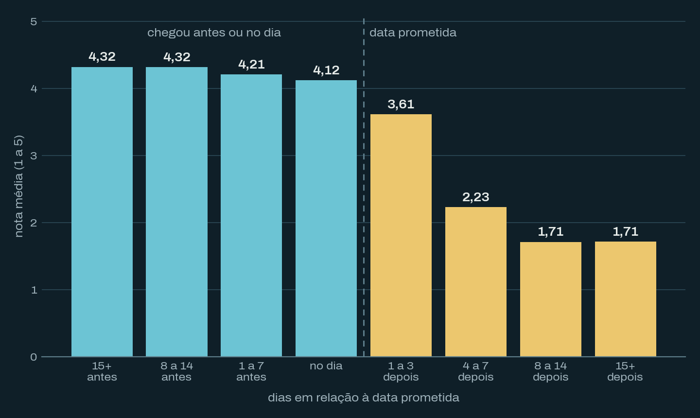

Quando terminei a parte de entregas do projeto com os dados da Olist, um número me chamou a atenção: pedidos entregues no prazo têm nota média 4,29, e os atrasados, 2,46. Quase dois pontos numa escala de 1 a 5. Mais do que o tamanho da diferença, me surpreendeu o formato: chegar adiantado melhora pouco a nota, mas passar da data prometida derruba logo. Só que, olhando mais de perto, boa parte dessa queda vem de clientes que avaliaram um pedido que ainda nem tinha chegado.

## A pergunta

O atraso na entrega derruba a avaliação do cliente? E, se derruba, a nota cai aos poucos conforme o atraso cresce ou despenca de uma vez?

Isso interessa a quem define o prazo que aparece para o cliente na hora da compra. Se o que pesa é cumprir a promessa, e não a velocidade em si, prometer um prazo realista pode valer mais do que tentar entregar rápido.

## 96 mil pedidos entregues

Usei o [dataset público da Olist no Kaggle](https://www.kaggle.com/datasets/olistbr/brazilian-ecommerce) (licença CC BY-NC-SA 4.0), com pedidos feitos entre 2016 e 2018.

| Tabela | Linhas | O que cada linha representa |
| ------ | -----: | --------------------------- |
| orders | 99.441 | um pedido, com datas de compra, entrega e prazo estimado |
| order_reviews | 99.224 | uma avaliação de 1 a 5 |

Fiquei só com os pedidos com status "entregue" e com data de entrega registrada: 96.470 (8 pedidos marcados como entregues não têm a data). Alguns pedidos têm mais de uma avaliação; mantive a mais recente. Tirando os pedidos sem avaliação, sobraram 95.824 pedidos com nota.

## O método

Fiz tudo em Python, com pandas para a preparação e scipy para os testes.

1. Calculei os dias entre a compra e a entrega e os dias entre a compra e a data prometida. A diferença é o atraso: positivo quando chegou depois do prometido, negativo quando chegou antes. Chegar no próprio dia prometido conta como no prazo.
2. Comparei a nota de quem recebeu no prazo com a de quem recebeu atrasado.
3. A nota é uma escala ordinal de 1 a 5, não uma variável contínua com distribuição normal, então usei o teste de Mann-Whitney em vez do teste t.
4. Separei o atraso em faixas para ver o formato da relação, e não só a média geral.
5. Comparei a data da avaliação com a data de entrega, para saber quem avaliou antes de receber.

O cálculo do atraso:

```python
df["delivery_days"] = (df["order_delivered_customer_date"] - df["order_purchase_timestamp"]).dt.days
df["days_to_estimated"] = (df["order_estimated_delivery_date"] - df["order_purchase_timestamp"]).dt.days
df["delivery_delay_days"] = df["delivery_days"] - df["days_to_estimated"]
```

## Passar do prazo custa quase dois pontos

| Entrega | Pedidos | Nota média | Notas 1 ou 2 | Nota 5 |
| ------- | ------: | ---------: | -----------: | -----: |
| No prazo | 88.677 | 4,29 | 9,2% | 62,4% |
| Atrasada | 7.147 | 2,46 | 57,1% | 20,2% |

Mais da metade dos pedidos atrasados recebeu nota 1 ou 2. Entre os que chegaram no prazo, foram 9%. A diferença é estatisticamente significativa (Mann-Whitney, p < 0,001), mas com quase 96 mil pedidos até uma diferença pequena seria. O que conta aqui é o tamanho: quase 2 pontos de média.

A nota cai assim que a entrega passa da data prometida:


*Nota média (1 a 5) por faixa de atraso, em dias em relação à data prometida. Fonte: dataset público da Olist (Kaggle). Elaboração própria.*

Do lado adiantado, a nota varia pouco. Quem recebeu 15 dias ou mais antes e quem recebeu de 8 a 14 dias antes deu a mesma média (4,32); de 1 a 7 dias antes, 4,21; no dia, 4,12. Chegar bem adiantado rende uns 0,2 ponto a mais do que chegar no dia. Depois da data prometida, a queda é rápida: 3,96 com um dia de atraso, 3,56 com dois e 2,92 com três. Com 4 a 7 dias, a média vai para 2,23, e a partir de 8 dias fica em 1,71.

Isso ajuda a entender por que a correlação de Spearman entre atraso e nota sai fraca (−0,18) mesmo com um efeito tão grande. Spearman mede se, ao longo de toda a escala, mais atraso vem acompanhado de nota menor. Só que 92% dos pedidos chegaram dentro do prazo, onde a nota quase não muda. A queda forte acontece numa fatia pequena dos dados, e o coeficiente dilui esse efeito.

O prazo prometido também é folgado: a mediana é de 23 dias, contra 10 dias de entrega real. Mesmo assim, 7,6% dos pedidos entregues estouraram o prazo (a conta inclui os pedidos sem avaliação, por isso não bate exatamente com os 7.147 da tabela).

## Dois terços avaliaram antes de receber

A Olist manda a pesquisa de satisfação perto da data prometida. Quando o pedido atrasa, o cliente pode responder antes de o pacote chegar, e aí a nota mede "meu pedido não chegou", não a experiência com o produto. Comparei a data em que cada avaliação foi criada com a data de entrega:

| Entrega | Quando avaliou | Pedidos | Nota média |
| ------- | -------------- | ------: | ---------: |
| No prazo | depois de receber | 88.459 | 4,29 |
| Atrasada | depois de receber | 2.389 | 3,69 |
| Atrasada | antes de receber | 4.758 | 1,84 |

(Só 218 pedidos entregues no prazo foram avaliados antes de chegar, e deixei esse grupo fora da tabela.)

Dos pedidos atrasados, 66,6% foram avaliados antes da entrega, com nota média 1,84. Entre os atrasados avaliados depois de receber, a nota é 3,69: cerca de 0,6 ponto abaixo de quem recebeu no prazo.

Então o atraso derruba a nota nos dois casos, mas por motivos diferentes. A maior parte da queda de quase 2 pontos vem de quem ainda estava esperando o pedido. Para quem já tinha o produto em mãos, o atraso pesa bem menos. Na prática, isso sugere duas ações separadas: avisar o cliente sobre o atraso antes de a pesquisa chegar, e melhorar a entrega em si.

## As limitações

Correlação não é causa. Pedidos atrasados podem vir com outros problemas, como produto avariado ou extravio parcial, que também derrubam a nota. O dataset não separa o motivo da avaliação.

Só o prazo prometido vem sem horário, então "no dia" conta como dentro do prazo, mesmo que o pacote tenha chegado no fim do dia. Pelo mesmo motivo, comparei avaliação e entrega pela data, sem considerar o horário.

Pedidos sem avaliação ficaram de fora. Não sei se quem não avalia se comporta igual a quem avalia.

Os dados não dizem se prometer um prazo maior faz o cliente desistir da compra. A ideia de "prometer um prazo realista" tem esse custo, que eu não consigo medir aqui.

E é uma empresa só, num período só: Olist entre 2016 e 2018. Não dá para dizer que outros marketplaces se comportam igual.

## Próximos passos

Quero separar o atraso que vem do vendedor (quando ele posta o pacote depois do prazo) do atraso que acontece depois da postagem. No [notebook de vendedores](https://github.com/ViniciusBelo/olist-ecommerce-analysis/blob/main/notebooks/07_analise_vendedores.ipynb), vi que cerca de 73% dos atrasos acontecem mesmo com a postagem em dia, o que aponta mais para a transportadora ou para a estimativa de prazo do que para os vendedores.

O código completo está no repositório [olist-ecommerce-analysis](https://github.com/ViniciusBelo/olist-ecommerce-analysis), no notebook [`06_analise_entregas.ipynb`](https://github.com/ViniciusBelo/olist-ecommerce-analysis/blob/main/notebooks/06_analise_entregas.ipynb).
